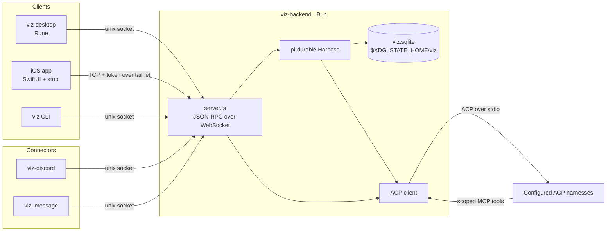

# Architecture

Current architecture. Plans live in `TODO.md`; reasons in `docs/decisions/`.

## Backend (`backend/`)

`viz-backend` is the only process that owns state. It opens a pi-durable `Harness` over SQLite (`openNodeSqliteStorage`, which runs on Bun's `node:sqlite`) at `$STATE_DIRECTORY` or `$XDG_STATE_HOME/viz/viz.sqlite`. pi-durable is single-writer: other processes never open the database; they talk to the backend.

- **Orchestrator**: pi-durable's reserved root conversation (`harness.root()`) and viz's only native model loop. It uses `CodingTools` and the `viz.memory`, `viz.orchestrator`, and `viz.orchestrator.tools` extensions. `viz.settings` stores the selected model and thinking level; config supplies defaults, instructions, cwd, and extensions. Its memory makes the history unbounded. Unlike ACP chats, the orchestrator cannot be renamed, pinned, archived, moved, or deleted.
- **Durability**: the orchestrator's model requests and tool calls are checkpointed pi-durable tasks. `requestId` on `conversation.submit` makes admission idempotent (connectors use the platform message id).

### ACP app chats

`conversation.create` makes an ownerless chat bound to an ACP runner and opens its session in the background. `viz.projects` on the root stores project directories; `viz.meta` stores the conversation's project, ACP parent, archive/pin/unread flags, worktree, and timestamps. Project branches come from Git's symbolic `HEAD`, including linked worktrees. A chat normally runs in its project directory or the orchestrator cwd. Moving a chat moves its descendants and requires affected turns to stop before their cwd changes. A bound worktree survives moving or archiving its chat and removing its project.

`conversation.delete` stops a chat and its descendants, withdraws queued inputs, and releases their runner processes. A tombstone in `viz.meta` hides them from lists, search, tools, and conversation RPCs. pi-durable does not remove conversation or transcript rows: they remain in `viz.sqlite`, and saved attachments stay on disk. viz removes a clean worktree it created when no remaining chat uses it, returns any paths it left in `kept`, and keeps the branches.

One durable worker drains each chat's inputs in order. The backend stores the runner's session id before its first prompt, keeps the process across turns, and reconnects with `session/resume` or `session/load` after restart or a cwd change. If the runner cannot restore the session, the turn fails instead of silently starting over. An interrupted prompt is never sent twice.

`conversation.state` exposes waiting inputs, which can be removed until they are placed. The orchestrator uses pi-durable's inbox; ACP uses its own durable chat queue. A chat becomes unread when it stops working with no app watching; watching clears the flag.

The runner advertises configuration options, modes, and slash commands. `viz.acp.state` stores the last options and commands and the user's desired values. The backend reapplies choices that differ on open or restore. Slash commands go to the runner as typed. viz allows every ACP permission request, choosing the first `allow_once` option, else `allow_always`, and cancels a request that offers neither; there is no sandbox.

File mentions search within the chat's cwd. With Git on `PATH`, its index and ignore rules determine candidates in a checkout; elsewhere a bounded walk excludes hidden directories, `node_modules`, and `target`. Searches cache file lists briefly and rank fuzzy basename matches before path-only matches.

Uploads up to 20 MiB each are saved under `attachments/<sha256>/<name>` in the state directory; prompt entries contain their names, MIME types, and paths. ACP receives file links and readable paths, and an image block when the runner accepts it. The orchestrator sends supported images inline and passes the saved paths in text.

### Git and transcript search

Worktree chats create a branch and linked checkout under `worktrees/<project-id>/` in the state directory. Before each ACP prompt in a Git repo, a temporary index captures tracked and non-ignored untracked files without altering the user's index. `viz.checkpoints` maps prompt entry IDs to commits retained by Git refs. Turn diffs compare to the next checkpoint or the current tree; revert restores the files without resetting the branch or index. Backend Git mutations share a per-working-tree lock. Checkout, commit, and revert refuse to modify a working tree during a viz turn.

`search.sqlite` is a derived FTS5 index of prompt text, assistant answers, and tool names. Startup backfills from per-conversation entry cursors; the commit observer indexes new entries. Hits carry their original conversation and entry IDs. Older transcript pages come directly from pi-durable, using an exclusive entry ID cursor.

Legacy native app chats keep their visible transcript. Their next input starts an ACP session; their old native history is not sent to the new runner.

### ACP delegation

The orchestrator delegates with `spawn_chat`, which starts a visible, top-level ACP chat and returns without waiting. Legacy task-owned `subagent` calls and their child transcripts remain visible; the children stay nested under their parent and accept follow-ups through the chat worker. Startup aborts any still-active legacy tool task and does not resend a previously dispatched ACP prompt.

Each ACP process gets a per-conversation token for viz's MCP tools over loopback HTTP, or a local stdio bridge for runners without HTTP support. An active turn can call `report_progress`, `spawn_subagent`, `list_subagents`, `read_subagent`, `message_subagent`, and `cancel_subagent`. The token never grants access outside the caller's descendants. Spawning creates an ownerless ACP chat nested under the caller, with the task's first line as its title, and inherits its project and cwd. Spawn and message can optionally return without waiting for the answer.

An MCP result carries a turn-scoped receipt so viz can attach it to the corresponding ACP tool update without guessing from tool titles or request order. When the runner forwards the receipt, the parent transcript stores `viz` (the MCP tool name) and, for calls that target one child, `child` (the child conversation ID) on its `viz.agent.tool` entry. The receipt itself is removed from the stored tool output.

The MCP endpoint (`mcp/server.ts`) is the official SDK (`@modelcontextprotocol/server`, `createMcpHandler`), serving the 2026-07-28 protocol and stateless 2025-era clients. viz refuses browser origins and checks the bearer token before a request reaches the SDK; the SDK builds a server per request whose tools act as the token's conversation. Tool inputs are pi-schema JSON Schemas wrapped with `fromJsonSchema`. The bridge (`viz-backend mcp-bridge`) relays the SDK's stdio server transport to its Streamable HTTP client transport, which adds the protocol headers each message needs.

App chats and orchestrator delegation use `[backend].default_harness` when no runner is given. ACP-spawned subagents inherit the caller's runner unless overridden. With exactly one configured runner, it is the implicit default; without a default, new app chats and orchestrator delegations must name a runner.

### Orchestrator tools

`orchestrator-tools.ts` gives the orchestrator `list_conversations` (projects and top-level ACP chats with status and unread flags), `read_conversation`, `search_conversations`, `spawn_chat` (optionally in a project worktree), `message_conversation`, and `cancel_conversation`. The toolkit cannot address or list nested subagents directly. Search attributes matches in their transcripts to the top-level chat and returns at most one hit per chat. The app RPCs still list nested chats with their parent and status.

`spawn_chat` and `message_conversation` return at once. In one commit of the tool's task they create the chat or queue the input, start a background `viz.orchestrator.report` task on the root, and record the conversation in the task-scoped `viz.orchestrator.call` document, so a replay returns the same conversation instead of starting another. A worktree is memoized on the tool task. The report task waits for the input to settle, across restarts, and submits `[chat N "title"] finished: …` or `… stopped (reason)` to the orchestrator once (keyed by its task ID); an idle orchestrator starts a new turn, a busy one gets it steered in. Report tasks are background tasks, so aborting the orchestrator's turn leaves them running.

## Memory (`backend/src/memory/`)

The orchestrator's memory is a port of uniichat's (`docs/findings/uniichat.md`; source `Memory.ts`, `prompt.txt` at `0500bf6`), on pi-durable's run loop instead of uniichat's:

- `sync.ts` derives messages from the orchestrator's transcript as entries commit (a watch on the root): user inputs `user`, answers `viz`, each tool call with its result as `tool` + `echo`. The cursor is stored with the messages, so the derivation is exactly-once across crashes. The pi-durable transcript stays the source of truth.
- `memory.ts` keeps those messages and the summary tree in `$STATE_DIRECTORY/memory.sqlite`: every message becomes a ≤512-byte line (as is if it fits, else written by the `[memory].compactor` model), adjacent lines merge pairwise up the tree, 64 compactions at a time, a failing one asked again every 60 s. Two views over the tree (turns': 64-128 KB; compactions': 16-32 KB) merge their most-aged pairs down to half when full, so a view changes only at its end between batches and stays prompt-cache friendly.
- `extension.ts`: a turn starts from a fresh context (`VizHarness.submit` resets the idle orchestrator before a new input; inputs while it works are steered into the running turn). Before each model request, `beforeRequest` waits until every message before the turn is summarized and puts the view in front of the turn's first message ("Turn: the user's new message"); on Anthropic, `beforeProviderRequest` marks the view's last whole 4-line block for the prompt cache. Tools: `zoom(id, n, at)` opens a line into its halves or a message whole, `date(id)`.
- `prompt.ts`: uniichat's prompt adapted to viz; compactions use its memory part as their whole system prompt.

Not ported: imports of other chats, images, `zoom` on a subagent's chat, billing holds.

## Protocol (`backend/src/protocol.ts`)

JSON-RPC 2.0 over a WebSocket at `/v1/rpc`, plus `GET /v1/health`. `protocol.ts` is the source of truth (pi-schema builders); `bun run schema` emits `protocol/schema.json` for the Rust and Swift clients. Clients call `hello` first with `{ kind: app | connector | cli, name }`.

Listeners (see `docs/decisions/0001-remote-transport.md`):

- Unix socket `$XDG_RUNTIME_DIR/viz/backend.sock`, mode 0600: local clients, no token.
- Optional TCP `[backend].listen` (a tailnet or LAN address): bearer token required (`Authorization` header, or `?token=` for clients that can't set headers).

## Message routing

Every connector input goes into the orchestrator (or a named conversation) with an `origin` (`connector`, `channel`, optional `thread`/`message`/`author`). The backend stores the origin with the transcript entry (`kind: "viz.input"`, `data.origin`) and prefixes the model-visible text with a tag like `[discord #123 @alice]`, so the orchestrator knows where an input came from.

- **Connectors** receive only `reply` notifications for inputs whose `origin.connector` is their own `hello` name, and render just those replies.
- **Apps** watch conversations for `conversation.view` (snapshot, then Chord deltas) and `conversation.state` (status, cwd, options, commands, queued inputs, attachment capability, and Git status). Stored pi-durable commits drive debounced `conversations.changed` notifications; apps then reload their conversation and project lists. Git state also refreshes on Git RPCs and every five seconds for watched conversations.

Reply routing is in-memory today: a reply to a connector that is disconnected when the answer lands is dropped (durable outbox: `TODO.md`).

## Configuration

One TOML document, layered from `config.toml` + `config.d/*.toml` in `$XDG_CONFIG_HOME/viz`, read independently by the backend (TS) and every Rust component; each parses only its own sections. Home Manager writes `config.toml` (read-only link, or merged into a writable file with `mutableSettings`). Reference: `docs/config.md`; rationale: `docs/decisions/0002-config-layering.md`.

## Nix

- `packages`: `viz-backend` (bun2nix, `bun build --compile`), `viz`, `viz-discord`, `viz-imessage`, `viz-desktop` (crane; desktop wrapped with Rune's runtime libraries), `default` (all).
- `checks`: clippy, backend `bun check`, treefmt. No tests (`AGENTS.md`).
- `homeModules.default`: `programs.viz` with `settings`, `mutableSettings`, `environmentFile`, `backend.enable`, `desktop.enable`, `connectors.<name>.enable`; systemd user services `viz-backend` (`StateDirectory=viz`, `RuntimeDirectory=viz`) and `viz-<connector>`.
- Dev shell: nightly Rust, Bun, bun2nix, Swift 6.4 + xtool from the `nixpkgs-xtool` input (nixpkgs PR #548520, same as vidhanix), Rune's libraries.

## Relation to reference projects

- **uniichat** (`docs/findings/uniichat.md`): the single never-ending chat, its summary-tree memory with `zoom` (above), and every window being a live view of server-owned state.
- **t3code** (`docs/findings/t3code.md`): the contract-only protocol module, per-thread snapshot + delta subscriptions, idempotent commands, token-authenticated remote access over tailnet, capability-driven harness adapters, and MCP as the tool surface for spawned harnesses.
- **ACP** (`docs/findings/acp.md`): viz is an ACP client for app chats and external delegations.
