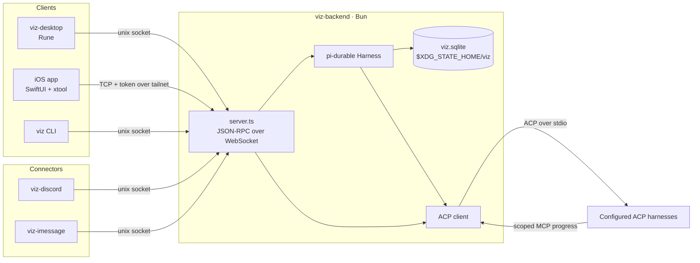

# Architecture

Current architecture. Plans live in `TODO.md`; reasons in `docs/decisions/`.

## Backend (`backend/`)

`viz-backend` is the only process that owns state. It opens a pi-durable `Harness` over SQLite (`openNodeSqliteStorage`, which runs on Bun's `node:sqlite`) at `$STATE_DIRECTORY` or `$XDG_STATE_HOME/viz/viz.sqlite`. pi-durable is single-writer: other processes never open the database; they talk to the backend.

- **Orchestrator**: pi-durable's reserved root conversation (`harness.root()`) and viz's only native model loop. It uses the `CodingTools`, `viz.memory`, `viz.orchestrator` (turns prompt) and `viz.subagent` extensions. Model, thinking level, instructions, cwd and extensions are re-applied from config on every start. Its history is unbounded through its memory (below).
- **Durability**: the orchestrator's model requests and tool calls are checkpointed pi-durable tasks. `requestId` on `conversation.submit` makes admission idempotent (connectors use the platform message id).

### ACP app chats

`conversation.create` makes an ownerless conversation for an app chat. The backend binds the chat to an ACP runner and retains its subprocess and session across turns. After a backend restart, it reconnects to the same session using ACP `session/resume` or `session/load`. If it cannot restore the session, the turn fails instead of silently starting a fresh chat.

One durable worker drains each chat's inputs in order. The backend stores the runner's session ID before sending its first prompt and records progress in that chat's transcript. An interrupted prompt is never sent twice.

Legacy native app chats keep their visible transcript. Their next input starts an ACP session; their old native history is not sent to the new runner.

### ACP delegation

The `subagent` tool creates a task-owned conversation; UIs can attach through `details.conversationId`. The calling conversation supplies the working directory. Each delegation runs one turn in its own ACP process and session. The child is a read-only transcript of text, reasoning, tool status, plans, and progress. The subprocess gets only a scoped `report_progress` tool over loopback HTTP MCP (a local stdio bridge for harnesses without HTTP capability). Its token is revoked when the turn ends.

Cancellation sends `session/cancel` and closes the process. An interrupted external prompt is not resent after restart: ACP has no idempotency key for prompts, so replaying could repeat side effects. A committed outcome is reused when pi-durable replays the parent tool.

Both app chats and delegation use `[backend].default_harness` unless the chat is already bound to a runner or the delegation names another configured harness. With exactly one configured harness it is the implicit default. With several and no explicit default, existing chats can still use their bound runner and delegations can name one; starting a new default chat or subagent requires a default. With none configured, the orchestrator still works, but app chat creation fails and `subagent` is unavailable.

## Memory (`backend/src/memory/`)

The orchestrator's memory is a port of uniichat's (`docs/findings/uniichat.md`; source `Memory.ts`, `prompt.txt` at `0500bf6`), on pi-durable's run loop instead of uniichat's:

- `sync.ts` derives messages from the orchestrator's transcript as entries commit (a watch on the root): user inputs `user`, answers `viz`, each tool call with its result as `tool` + `echo`. The cursor is stored with the messages, so the derivation is exactly-once across crashes. The pi-durable transcript stays the source of truth.
- `memory.ts` keeps those messages and the summary tree in `$STATE_DIRECTORY/memory.sqlite`: every message becomes a ≤512-byte line (as is if it fits, else written by the `[memory].compactor` model), adjacent lines merge pairwise up the tree, 64 compactions at a time, a failing one asked again every 60 s. Two views over the tree (turns': 64-128 KB; compactions': 16-32 KB) merge their most-aged pairs down to half when full, so a view changes only at its end between batches and stays prompt-cache friendly.
- `extension.ts`: a turn starts from a fresh context (`VizHarness.submit` resets the idle orchestrator before a new input; inputs while it works are steered into the running turn). Before each model request, `beforeRequest` waits until every message before the turn is summarized and puts the view in front of the turn's first message ("Turn: the user's new message"); on Anthropic, `beforeProviderRequest` marks the view's last whole 4-line block for the prompt cache. Tools: `zoom(id, n, at)` opens a line into its halves or a message whole, `date(id)`.
- `prompt.ts`: uniichat's prompt adapted to viz; compactions use its memory part as their whole system prompt.

Not ported: imports of other chats, images, `zoom` on a subagent's chat, billing holds.

## Protocol (`backend/src/protocol.ts`)

JSON-RPC 2.0 over a WebSocket at `/v1/rpc`, plus `GET /v1/health`. `protocol.ts` is the source of truth (pi-schema builders); `bun run schema` emits `protocol/schema.json` for the Rust and Swift clients. Clients call `hello` first with `{ kind: app | connector | cli, name }`.

Listeners (see `docs/decisions/0001-remote-transport.md`):

- Unix socket `$XDG_RUNTIME_DIR/viz/backend.sock`, mode 0600: local clients, no token.
- Optional TCP `[backend].listen` (a tailnet or LAN address): bearer token required (`Authorization` header, or `?token=` for clients that can't set headers).

## Message routing

Every connector input goes into the orchestrator (or a named conversation) with an `origin` (`connector`, `channel`, optional `thread`/`message`/`author`). The backend stores the origin with the transcript entry (`kind: "viz.input"`, `data.origin`) and prefixes the model-visible text with a tag like `[discord #123 @alice]`, so the orchestrator knows where an input came from.

- **Connectors** receive only `reply` notifications for inputs whose `origin.connector` is their own `hello` name, and render just those replies.
- **Apps** (desktop, iOS) `conversation.watch` conversations and receive the full view (`conversation.view`: full value, then Chord delta ops): every message from every source, tool calls, subagents, live state.

Reply routing is in-memory today: a reply to a connector that is disconnected when the answer lands is dropped (durable outbox: `TODO.md`).

## Configuration

One TOML document, layered from `config.toml` + `config.d/*.toml` in `$XDG_CONFIG_HOME/viz`, read independently by the backend (TS) and every Rust component; each parses only its own sections. Home Manager writes `config.toml` (read-only link, or merged into a writable file with `mutableSettings`). Reference: `docs/config.md`; rationale: `docs/decisions/0002-config-layering.md`.

## Nix

- `packages`: `viz-backend` (bun2nix, `bun build --compile`), `viz`, `viz-discord`, `viz-imessage`, `viz-desktop` (crane; desktop wrapped with Rune's runtime libraries), `default` (all).
- `checks`: clippy, backend `bun check`, treefmt. No tests (`AGENTS.md`).
- `homeModules.default`: `programs.viz` with `settings`, `mutableSettings`, `environmentFile`, `backend.enable`, `desktop.enable`, `connectors.<name>.enable`; systemd user services `viz-backend` (`StateDirectory=viz`, `RuntimeDirectory=viz`) and `viz-<connector>`.
- Dev shell: nightly Rust, Bun, bun2nix, Swift 6.4 + xtool from the `nixpkgs-xtool` input (nixpkgs PR #548520, same as vidhanix), Rune's libraries.

## Relation to reference projects

- **uniichat** (`docs/findings/uniichat.md`): the single never-ending chat, its summary-tree memory with `zoom` (above), and every window being a live view of server-owned state.
- **t3code** (`docs/findings/t3code.md`): the contract-only protocol module, per-thread snapshot + delta subscriptions, idempotent commands, token-authenticated remote access over tailnet, capability-driven harness adapters, and MCP as the tool surface for spawned harnesses.
- **ACP** (`docs/findings/acp.md`): viz is an ACP client for app chats and external delegations.
