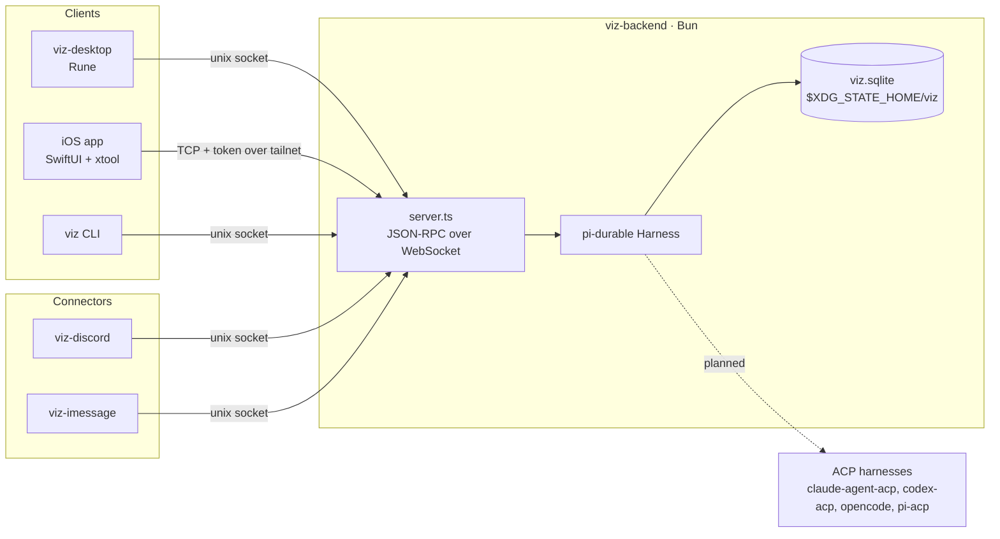

# Architecture

Current state as of the scaffold (2026-11-17). Plans live in `TODO.md`; reasons in `docs/decisions/`.

## Backend (`backend/`)

`viz-backend` is the only process that owns state. It opens a pi-durable `Harness` over SQLite (`openNodeSqliteStorage`, which runs on Bun's `node:sqlite`) at `$STATE_DIRECTORY` or `$XDG_STATE_HOME/viz/viz.sqlite`. pi-durable is single-writer: other processes never open the database; they talk to the backend.

- **Orchestrator**: pi-durable's reserved root conversation (`harness.root()`). Created on first open with the `CodingTools`, `viz.orchestrator` (system prompt section), and `viz.subagent` extensions; model, thinking level, instructions and cwd are re-applied from `[orchestrator]` on every start. History is unbounded: pi-durable keeps every entry on disk and compacts the model's context in the background.
- **Subagents**: the `subagent` tool creates a conversation owned by the tool call (`ownership: { kind: "task" }`), so aborting the call aborts it, a crash resumes it, and UIs can attach to it through the call's `details.conversationId`. Uses `[subagents].model` if set.
- **App chats**: `conversation.create` makes an ownerless conversation, the sidebar's other entries.
- **Durability**: every model request and tool call is a checkpointed pi-durable task. `requestId` on `conversation.submit` makes admission idempotent (connectors use the platform message id).

## Protocol (`backend/src/protocol.ts`)

JSON-RPC 2.0 over a WebSocket at `/v1/rpc`, plus `GET /v1/health`. `protocol.ts` is the source of truth (pi-schema builders); `bun run schema` emits `protocol/schema.json` for the Rust and Swift clients. Clients call `hello` first with `{ kind: app | connector | cli, name }`.

Listeners (see `docs/decisions/0001-remote-transport.md`):

- Unix socket `$XDG_RUNTIME_DIR/viz/backend.sock`, mode 0600: local clients, no token.
- Optional TCP `[backend].listen` (a tailnet or LAN address): bearer token required (`Authorization` header, or `?token=` for clients that can't set headers).

## Message routing

Every connector input goes into the orchestrator (or a named conversation) with an `origin` (`connector`, `channel`, optional `thread`/`message`/`author`). The backend stores the origin with the transcript entry (`kind: "viz.input"`, `data.origin`) and prefixes the model-visible text with a tag like `[discord #123 @alice]`, so the orchestrator knows where an input came from.

- **Connectors** receive only `reply` notifications for inputs whose `origin.connector` is their own `hello` name, and render just those replies.
- **Apps** (desktop, iOS) `conversation.watch` conversations and receive the full view (`conversation.view`: full value, then Chord delta ops): every message from every source, tool calls, subagents, live state.

Reply routing is in-memory today: a reply to a connector that is disconnected when the answer lands is dropped (durable outbox: `TODO.md`).

## Configuration

One TOML document, layered from `config.toml` + `config.d/*.toml` in `$XDG_CONFIG_HOME/viz`, read independently by the backend (TS) and every Rust component; each parses only its own sections. Home Manager writes `config.toml` (read-only link, or merged into a writable file with `mutableSettings`). Reference: `docs/config.md`; rationale: `docs/decisions/0002-config-layering.md`.

## Nix

- `packages`: `viz-backend` (bun2nix, `bun build --compile`), `viz`, `viz-discord`, `viz-imessage`, `viz-desktop` (crane; desktop wrapped with Rune's runtime libraries), `default` (all).
- `checks`: clippy, cargo test, backend `bun check` + `bun test`, treefmt.
- `homeModules.default`: `programs.viz` with `settings`, `mutableSettings`, `environmentFile`, `backend.enable`, `desktop.enable`, `connectors.<name>.enable`; systemd user services `viz-backend` (`StateDirectory=viz`, `RuntimeDirectory=viz`) and `viz-<connector>`.
- Dev shell: nightly Rust, Bun, bun2nix, Swift 6.4 + xtool from the `nixpkgs-xtool` input (nixpkgs PR #548520, same as vidhanix), Rune's libraries.

## Relation to reference projects

- **uniichat** (`docs/findings/uniichat.md`): the single never-ending chat, subagents reporting back as messages, and every window being a live view of server-owned state are adopted. Its summary memory tree with `zoom` is planned as a viz extension on top of pi-durable (`TODO.md`); today the orchestrator relies on pi-durable's compaction, which also keeps all history on disk.
- **t3code** (`docs/findings/t3code.md`): the contract-only protocol module, per-thread snapshot + delta subscriptions, idempotent commands, token-authenticated remote access over tailnet, capability-driven harness adapters, and MCP as the tool surface for spawned harnesses.
- **ACP** (`docs/findings/acp.md`): the planned way viz drives other harnesses (viz is the ACP client; each external session maps to a viz conversation).
